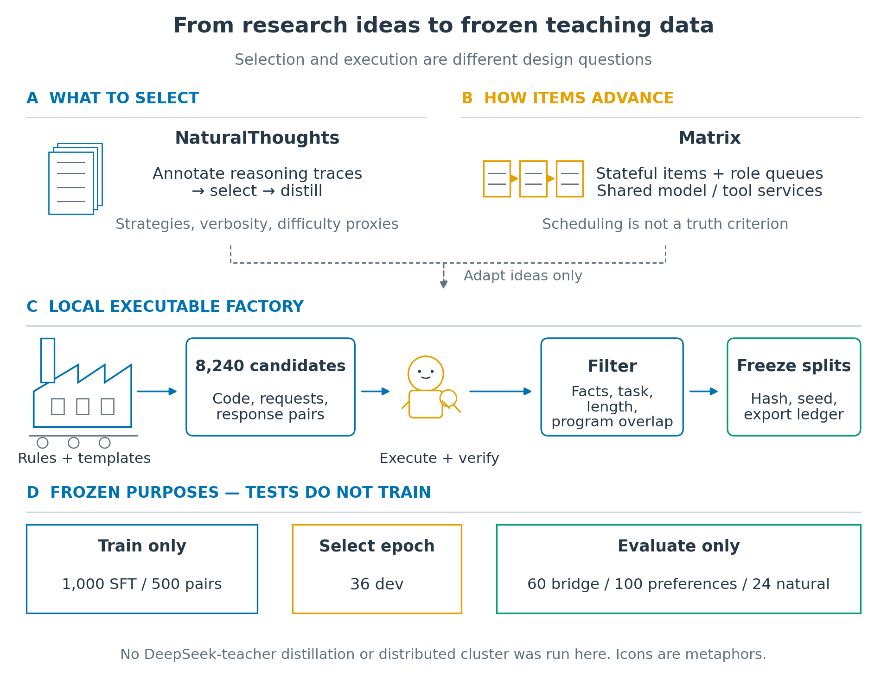

[English](README.md) | [简体中文](README.zh-CN.md)

# Verifiable Tutoring Lab

**Executable educational data, SFT–DPO comparisons, and evidence-backed learner memory.**

This research prototype studies whether a small language model can support introductory Python tutoring when its responses are checked against executable facts. It connects deterministic data synthesis, actual Qwen2.5-0.5B base-model post-training, a three-role tutoring controller, persistent memory, and a conditional service-feasibility analysis.

The central result is a reliability limitation: both cloud runs completed, but training did not produce a dependable tutor. Correct output values often accompanied false explanations; tool/template fallback supplied most final responses. Original failures and the separate numerical-audit review are retained.



## Reports and source

| Material | Preview / source | Download |
|---|---|---|
| English research report | [PDF preview](reports/research-report.en.pdf) | [Download PDF](https://github.com/DolomitiAugust/verifiable-tutoring-lab/raw/refs/heads/main/reports/research-report.en.pdf) |
| Chinese explanatory report | [PDF preview](reports/research-report.zh-CN.pdf) | [Download PDF](https://github.com/DolomitiAugust/verifiable-tutoring-lab/raw/refs/heads/main/reports/research-report.zh-CN.pdf) |
| Shared implementation | [Data](synthesis/), [training](training/), [agents](tutor/), [feasibility](business/) | [Repository ZIP](https://github.com/DolomitiAugust/verifiable-tutoring-lab/archive/refs/heads/main.zip) |
| Report and figure sources | [LaTeX](reports/source/), [plotting](reports/plotting/) | Included in repository |

Links require repository access while visibility is private.

## Research question

Can execution-checked synthetic data, preference tuning, and explicit learner memory support reliable Python feedback, and which parts of the observed behavior come from the model versus the controller?

## Methods

- **Data:** generate executable teaching examples, then select 1,000 SFT demonstrations and 500 preference pairs. Keep a candidate ledger, separate development/evaluation exports, and checks for reference correctness and cross-split overlap. NaturalThoughts and Matrix inform the analysis; their large-scale systems were not reproduced.
- **Post-training:** start with the official Qwen2.5-0.5B **base**, apply Q/V LoRA SFT, then DPO from the development-selected SFT parent. Each cloud run performs 3,000 SFT updates, 500 DPO updates, and a 500-update continued-SFT control. The control matches updates, not prompts, tokens, or compute.
- **Agents and memory:** planner, teacher, and reviewer share a model. A bounded interpreter checks facts; SQLite stores learner-scoped episodes and counters. Rejected model drafts, fallback decisions, two above-expectation successes, and two unexpected failures remain inspectable. An isolated rendering repair separates exercise delivery from answer disclosure.
- **Feasibility:** compare CodeGrade and Khanmigo using cited sources, then calculate review-workload, unit-economics, and cash scenarios. Commercial inputs are assumptions; customer demand and learning gains were not measured.

## Experiments

The first cloud run adapts the last eight Q/V layers; the exploratory run adapts all 24 layers and changes the SFT learning rate. Each uses 1,000 SFT examples, 500 training preference pairs, 36 development references, 24 natural questions, 60 bridge references, and 100 evaluation preference pairs. The same-project evaluation preserves raw answers and separate full-text judgments. Historical agent cases and later engineering controls use separately recorded protocols.

## Results and analysis

The fixed 24-question natural-expression set uses full-response primary-output review. **C/W/U = correct / wrong / unresolved**; unresolved is separate from wrong. Reference NLL is text likelihood, not accuracy.

| Stage | Natural reference NLL ↓ | C / W / U |
|---|---:|---:|
| Base | 3.7258 | 3 / 3 / 18 |
| First SFT | 3.5892 | 1 / 20 / 3 |
| First DPO | 4.2992 | 0 / 7 / 17 |
| First continued SFT | 3.4445 | 1 / 19 / 4 |
| Exploratory SFT | 3.5873 | 3 / 16 / 5 |
| Exploratory DPO | 6.6152 | 4 / 7 / 13 |
| Exploratory continued SFT | 3.5764 | 5 / 11 / 8 |

DPO worsened reference NLL on all 24 natural and 60 bridge items in each run. The historical 12-scenario agent study completed seven tasks, with all 17 final turns using tools/templates and no adopted role response. Later controls, checkpoint linkage, and engineering repairs are reported separately; they do not reclassify the historical cases.

## Reproduce and inspect

Python 3.11+ is recommended. The basic inspection path does not download weights or call a model:

```bash
python -m venv .venv
# Activate .venv using your shell's standard command.
python -m pip install -r requirements.txt
python -B scripts/verify_release.py
python -B -m unittest tutor.rendering.test_rendering -v
```

See [implementation and commands](docs/implementation.md) for dataset validation, training entry points, optional ML dependencies, and isolated output directories. Original model/checkpoint binaries are omitted; rerunning model experiments requires the pinned official model and newly generated adapters. Saved records can be inspected without training. Report compilation additionally needs Tectonic and the documented fonts; see [report/plot commands](reports/README.md).

## Limitations and provenance

Data are deterministic, template-based, and authored within the same project. The 1,000 SFT items cover 145 coarse structures; the 36-item development set covers four. Preference reasons correlate with task types. The exploratory run changes multiple settings after earlier test inspection; there is no larger-base comparison or causal data/parameter ablation. Small-sample, same-project review does not establish independent teaching quality. ID-scoped retrieval assumes a trusted caller and is not authentication.

Published files form a de-identified, reorganized research copy. Historical hashes describe original artifacts; [release verification](scripts/verify_release.py) checks the current publication files. No model training or inference was added for publication. See [publication scope](docs/publication.md), [AI assistance](docs/ai-assistance.md), and the reports for citations and interpretation boundaries.
