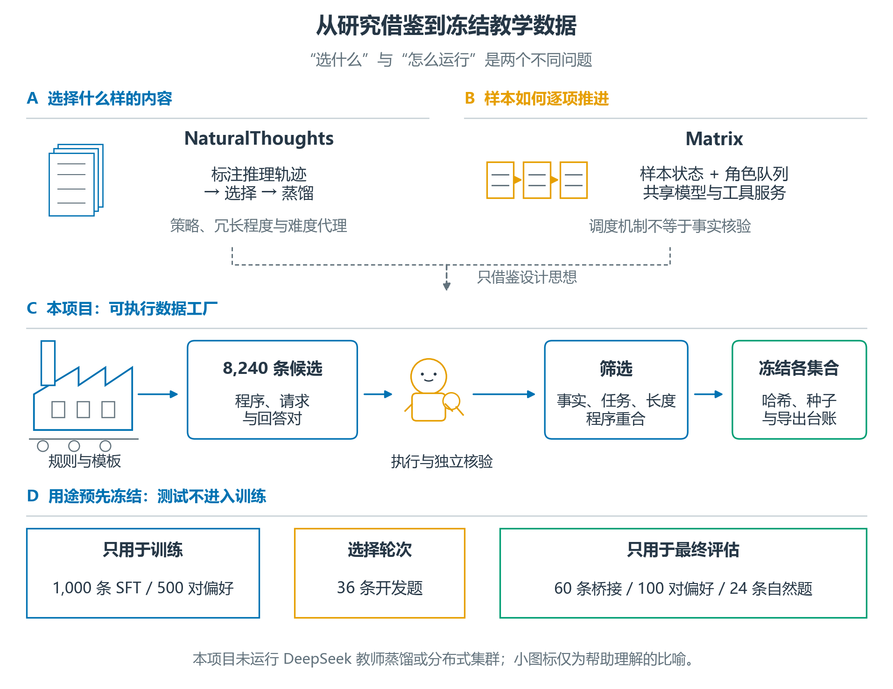

[English](README.md) | [简体中文](README.zh-CN.md)

# Verifiable Tutoring Lab · 可核验教学智能体研究

本项目研究一个具体问题：在大学 Python 入门教学中，能否通过可执行事实、角色分工和持久记忆，让小型语言模型提供更可靠的反馈？研究串联了数据合成、真实微调、教学系统和条件性商业分析。

实验链路已经运行，但模型的教学可靠性仍较差。回答中的数值正确不代表解释正确；系统给出了正确反馈，也可能主要依赖程序核验与模板回退。仓库保留这些失败及其原始证据，便于检查实际贡献。



## 报告、代码与下载

| 内容 | 在线预览或源码 | 下载 |
|---|---|---|
| 英文研究报告 | [PDF预览](reports/research-report.en.pdf) | [下载PDF](https://github.com/DolomitiAugust/verifiable-tutoring-lab/raw/refs/heads/main/reports/research-report.en.pdf) |
| 中文解释版报告 | [PDF预览](reports/research-report.zh-CN.pdf) | [下载PDF](https://github.com/DolomitiAugust/verifiable-tutoring-lab/raw/refs/heads/main/reports/research-report.zh-CN.pdf) |
| 共用代码 | [数据合成](synthesis/)、[训练评估](training/)、[教学系统](tutor/)、[商业测算](business/) | [下载整个仓库](https://github.com/DolomitiAugust/verifiable-tutoring-lab/archive/refs/heads/main.zip) |
| 文档与绘图源码 | [LaTeX](reports/source/)、[科研绘图](reports/plotting/) | 已包含在仓库中 |

仓库处于私有状态时，需要先获得访问权限才能使用这些链接。两语报告共用同一套实验代码和证据，中文增加概念解释与阅读提示。

## 研究问题

可执行数据、偏好优化和持久记忆能否共同支持可靠的Python教学反馈？观察到的效果来自模型本身，还是控制器、工具和模板？

## 方法与实现

### 1. 用执行结果约束数据

程序先构造题目、参考输出与教学请求，再筛选出1000条SFT示范和500对偏好数据。SFT提供“应该怎样回答”的示范；偏好对给出同一问题的首选与次选回答。完整候选账本记录入选理由和导出位置，开发集、桥接集、偏好测试和自然表达测试各有不同用途。

执行检查可以验证程序输出和部分数据规则，但不能保证中文解释具有良好的教学质量。NaturalThoughts与Matrix用于分析推理样本选择和生成流程组织，本项目没有复现它们的大规模分布式训练。

### 2. 实际运行SFT，再运行DPO

起点是官方Qwen2.5-0.5B基础模型。两轮云端实验各执行3000次SFT更新，从开发集参考NLL选择SFT检查点，再分别做500次DPO和500次继续SFT对照。继续SFT对照匹配新增更新次数，但未严格匹配提示、token数或算力。

NLL表示模型对给定参考文本的预测难度，越低表示该文本更容易被预测。它不是正确率。DPO比较两份回答相对于冻结参考模型的偏好差，因此偏好指标上升不保证正确回答本身更容易生成。

### 3. 区分模型、工具与记忆

规划、教学、评审三个角色共享一个模型，通过不同提示承担不同职责。受限解释器核验事实，模型可以解释已提供的证据；不满足规则的草稿被保留，并通过明确标注的工具/模板回退交付结果。

SQLite记录学生作答事件和派生计数，按学生标识与主题检索。记忆中的“正确次数”是行为记录，不是经过校准的知识掌握概率；调用者提供的ID也不能代替登录认证。原系统中的跨实例记忆、学生隔离、受限变式失败和空字符串记账失败均有实录。后续修复另行记录，未改写原案例成绩。

### 4. 商业可行性只做条件测算

竞品比较使用CodeGrade与Khanmigo官方资料，并保留研究引用。定价、复核比例、教师工时、采购转化和现金回款属于假设，没有实际客户或学生试点。测算说明：如果达到质量要求需要大量人工复核，原定价可能不成立。

## 实验设置

首轮云端实验适配最后8层的Q/V投影；探索性实验适配全部24层，并同时改变SFT学习率。两者分别使用1000条SFT、500对训练偏好、36条开发参考、24道自然题、60条桥接参考与100对评估偏好。角色系统的历史案例、后续控制组和修复采用不同协议，分别保存，不能跨组简单比较采用率。

## 关键结果与分析

下表对应固定的24道自然表达题。C/W/U分别表示完整回答主值判断中的正确、错误和未判定；解释是否正确另行审阅，不能把未判定直接算作错误。

| 阶段 | 自然题参考NLL ↓ | 正确 / 错误 / 未判定 |
|---|---:|---:|
| 基础模型 | 3.7258 | 3 / 3 / 18 |
| 首轮SFT | 3.5892 | 1 / 20 / 3 |
| 首轮DPO | 4.2992 | 0 / 7 / 17 |
| 首轮继续SFT对照 | 3.4445 | 1 / 19 / 4 |
| 探索性SFT | 3.5873 | 3 / 16 / 5 |
| 探索性DPO | 6.6152 | 4 / 7 / 13 |
| 探索性继续SFT对照 | 3.5764 | 5 / 11 / 8 |

两轮DPO在24条自然题和60条桥接参考上均使NLL变差。部分答案主值正确，但解释存在事实错误。历史教学系统12场景中7项完整完成，17轮最终回答全部来自工具/模板；后续模型联动与工程修复没有被合并成模型能力提升。

**已证实的限制**包括模板覆盖窄、偏好理由与任务类型关联、开发集结构少，以及上述实际评估结果。**可能原因**包括模型容量、数据表面线索和训练设置；没有同协议大模型对照或严格单因素消融，因此无法分配因果贡献，也没有证明过拟合是唯一原因。

## 局限

数据来自同一项目的确定性模板，尚无外部教师盲评或真实学生学习试验。单一训练种子、小测试集、探索性设置变化和未严格匹配的对照，限制了因果推断与推广。另行获取的同规模官方Instruct诊断模型也不能作为本项目训练收益。商业测算尚无真实采购与学习收益证据。

## 安装与基础检查

推荐Python 3.11或更新版本。以下命令检查文件和工具逻辑，不下载模型、不训练、不调用模型：

```bash
python -m venv .venv
# Windows PowerShell：.venv\Scripts\Activate.ps1
# Linux/macOS：source .venv/bin/activate
python -m pip install -r requirements.txt
python -B scripts/verify_release.py
python -B -m unittest tutor.rendering.test_rendering -v
```

[实现与操作说明](docs/implementation.md)解释数据验证、源码入口、可选机器学习依赖和运行参数。重新训练需要固定版本的官方模型，并重新生成适配器；仓库不包含大权重或优化器二进制。新运行应使用新的输出目录，避免覆盖已保存证据。重建报告还需要Tectonic和对应字体，具体见[报告与绘图命令](reports/README.md)。

## 发布内容与使用边界

此仓库是重新整理、脱敏后的研究副本，不带原Git历史。保留不同实验条件是为了比较研究结果，不是保存重复草稿。历史原件哈希与当前发布文件哈希的用途不同；当前文件由发布核验脚本检查。本次整理未增加模型实验。

原始第三方论文和网页全文未重新分发，引用保留在报告中。[发布范围](docs/publication.md)说明选取与转换规则，[模型辅助说明](docs/ai-assistance.md)说明AI参与和记录边界。尚未证明的学习收益、机构交付能力或商业需求，都不作为已完成成果。
