[English](figures.md) | [简体中文](figures.zh-CN.md)

# Scientific figure gallery

PNG images are embedded here for convenient online reading. Each figure links to its PNG, PDF and available SVG. The scientific observations match the reports; vector preview failures do not prevent downloading the source.

[Viewing/download help](../docs/viewing-files.md) · [English report](research-report.en.pdf)

## 1. Data synthesis and evaluation boundaries

[PNG](assets/en/synthesis-atlas.png) · [PDF](assets/en/synthesis-atlas.pdf) · [SVG](assets/en/synthesis-atlas.svg)

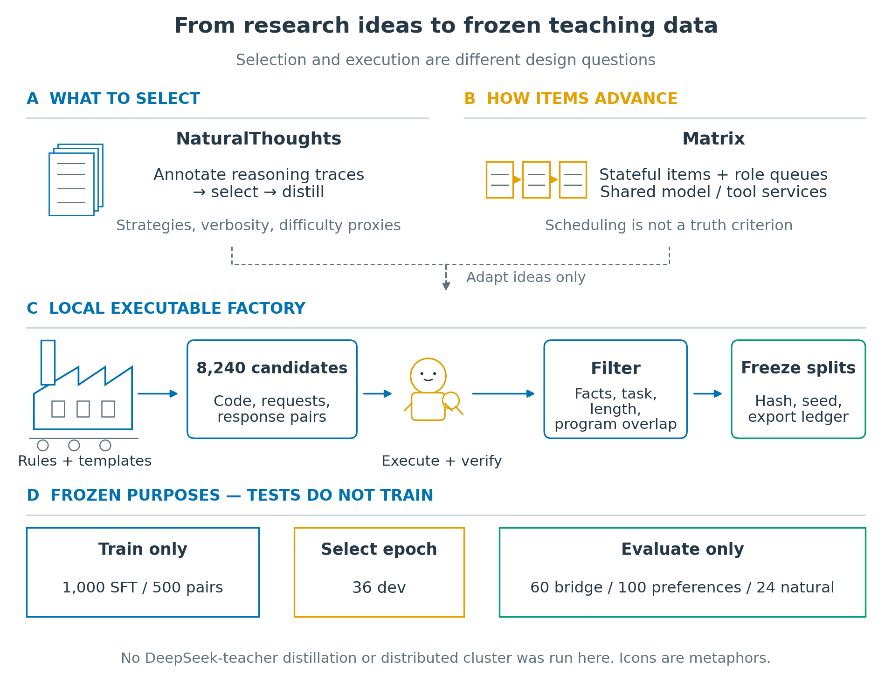

## 2. Selection-policy comparison

[PNG](assets/en/selection-ablation.png) · [PDF](assets/en/selection-ablation.pdf) · [SVG](assets/en/selection-ablation.svg)

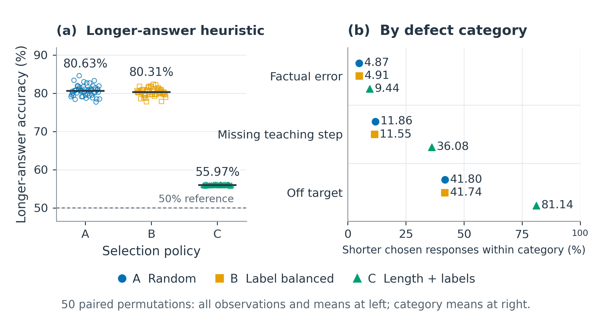

## 3. Shorter-response supply by family

[PNG](assets/en/family-supply.png) · [PDF](assets/en/family-supply.pdf) · [SVG](assets/en/family-supply.svg)

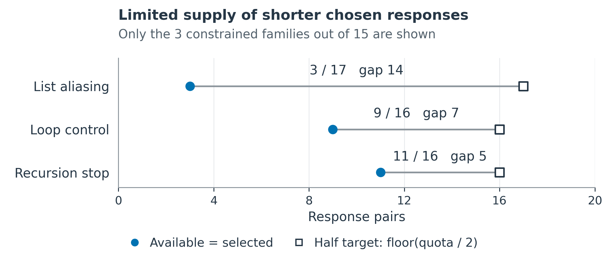

## 4. First-cloud itemwise evidence

[PNG](assets/en/training-v2-evidence.png) · [PDF](assets/en/training-v2-evidence.pdf) · [SVG](assets/en/training-v2-evidence.svg)

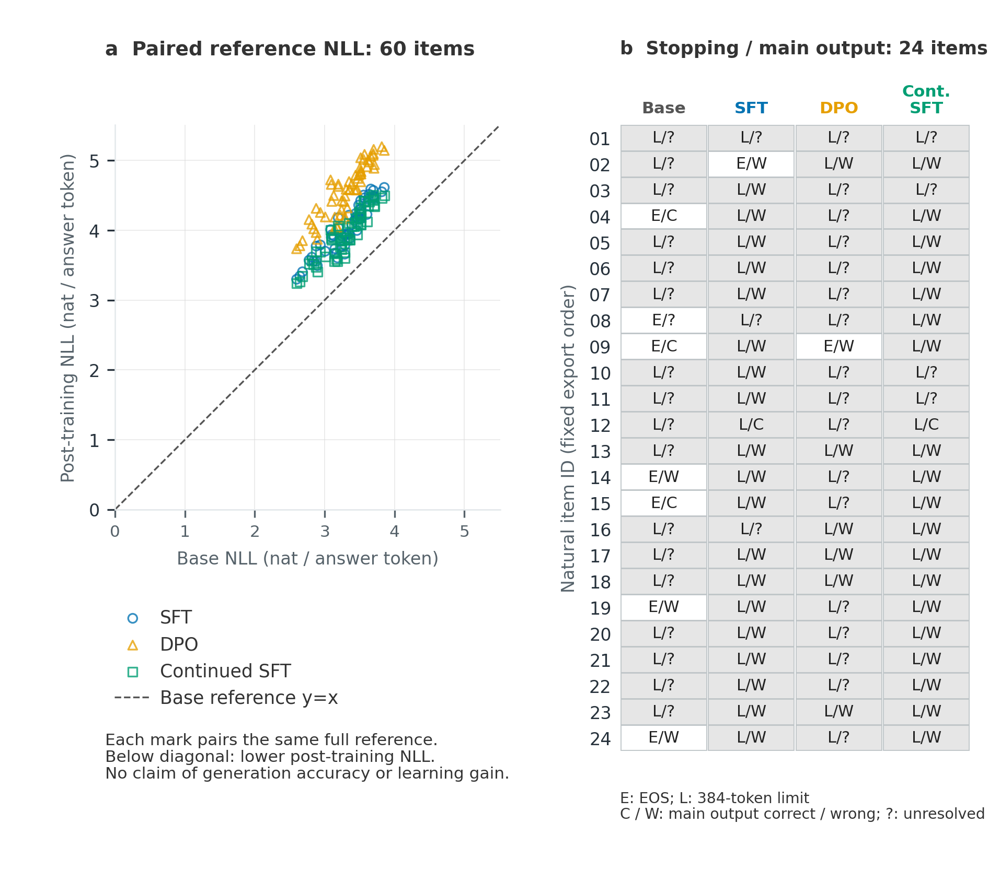

## 5. Exploratory training comparison

[PNG](assets/en/training-retry-comparison.png) · [PDF](assets/en/training-retry-comparison.pdf) · [SVG](assets/en/training-retry-comparison.svg)

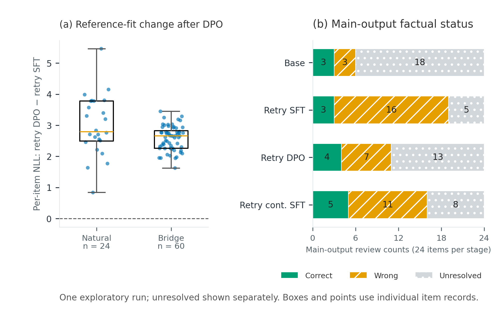

## 6. Relative objective and absolute likelihood

[PNG](assets/en/training-objective-gap.png) · [PDF](assets/en/training-objective-gap.pdf) · [SVG](assets/en/training-objective-gap.svg)

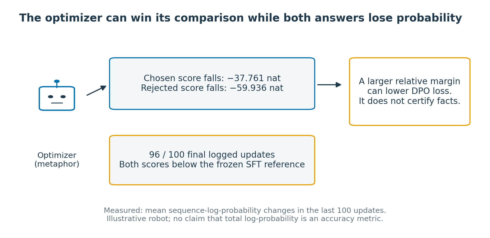

## 7. Teaching roles, evidence and memory

[PNG](assets/en/teaching-memory.png) · [PDF](assets/en/teaching-memory.pdf) · [SVG](assets/en/teaching-memory.svg)

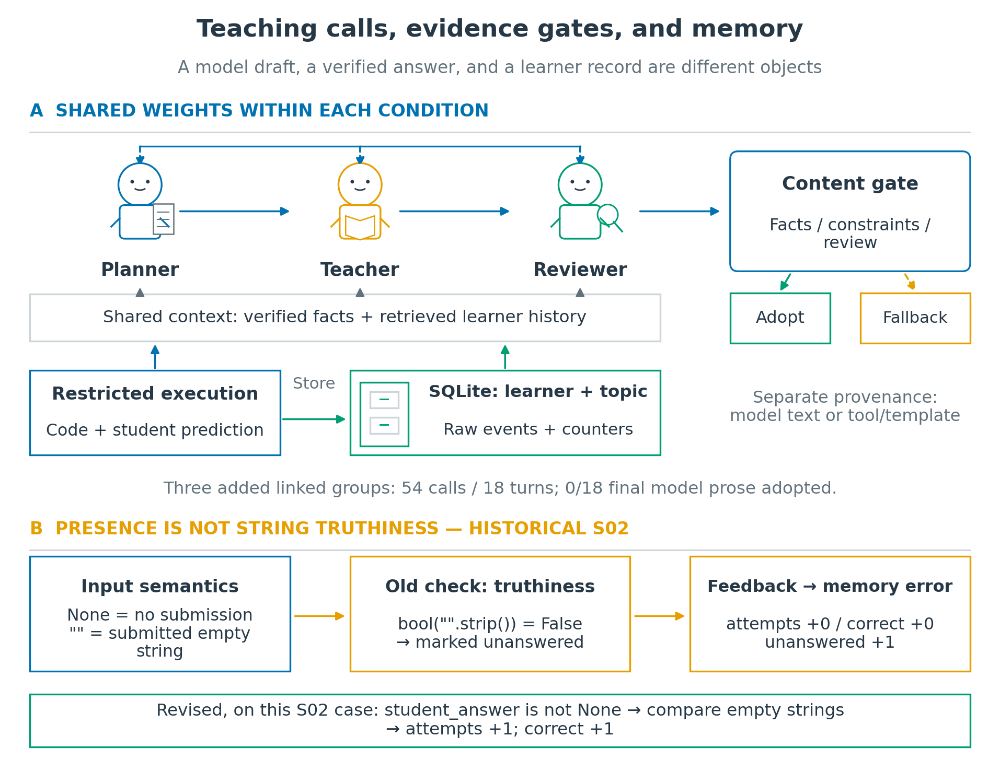

## 8. Historical agent and memory evidence

[PNG](assets/en/agents-evidence.png) · [PDF](assets/en/agents-evidence.pdf) · [SVG](assets/en/agents-evidence.svg)

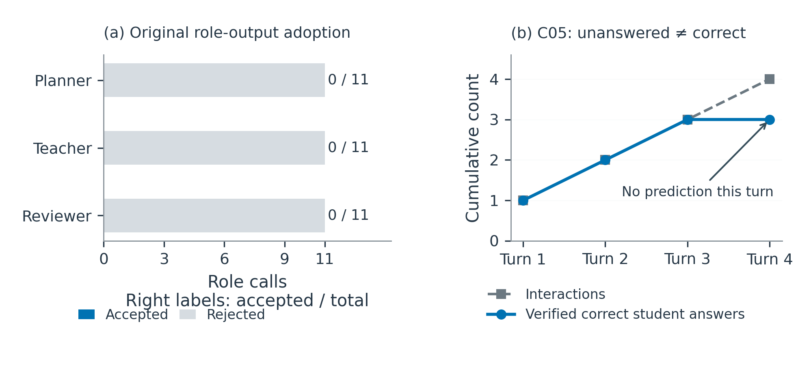

## 9. Four historical cases

[PNG](assets/en/case-outcomes.png) · [PDF](assets/en/case-outcomes.pdf) · [SVG](assets/en/case-outcomes.svg)

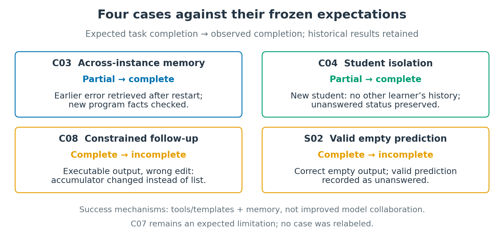

## 10. Controller and model provenance

[PNG](assets/en/agents-revision-provenance.png) · [PDF](assets/en/agents-revision-provenance.pdf) · [SVG](assets/en/agents-revision-provenance.svg)

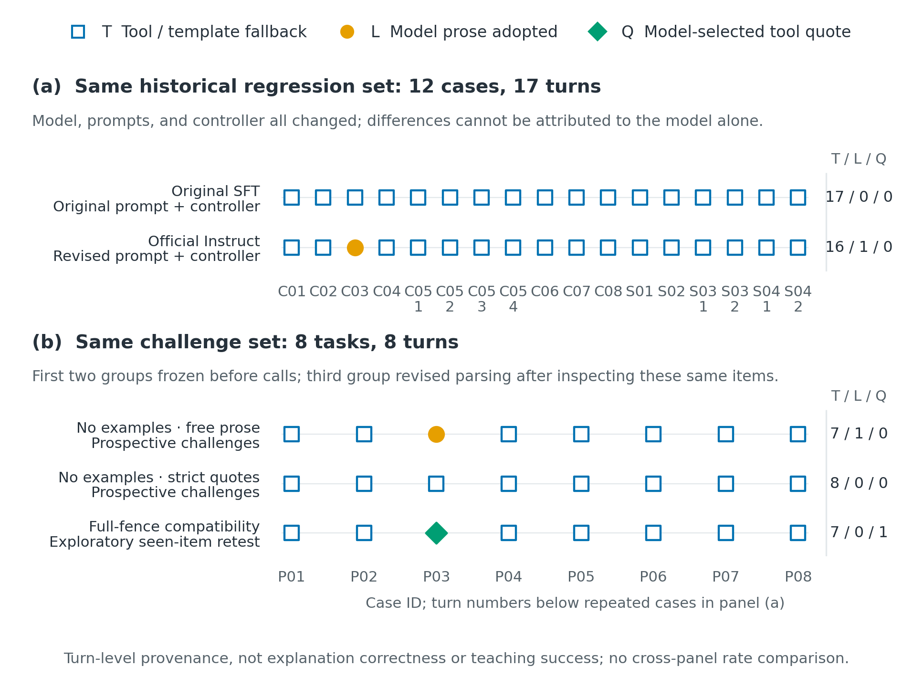

## 11. Evidence-to-pilot workflow

[PNG](assets/en/evidence-to-pilot.png) · [PDF](assets/en/evidence-to-pilot.pdf) · [SVG](assets/en/evidence-to-pilot.svg)

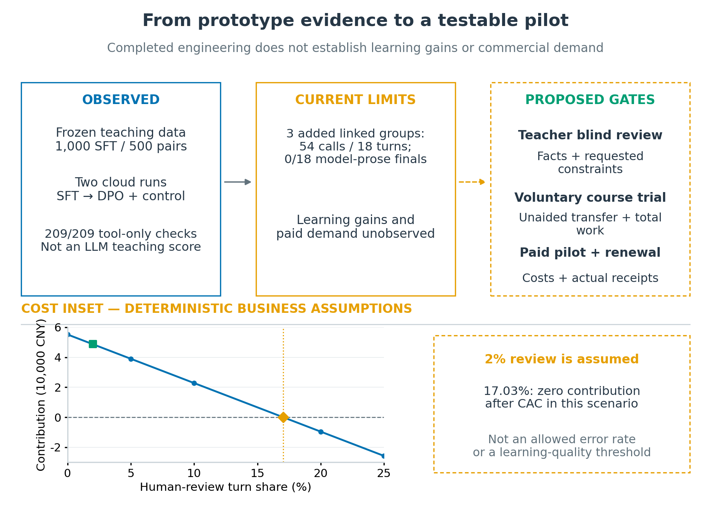

## 12. Conditional service costs

[PNG](assets/en/business-costs.png) · [PDF](assets/en/business-costs.pdf) · [SVG](assets/en/business-costs.svg)

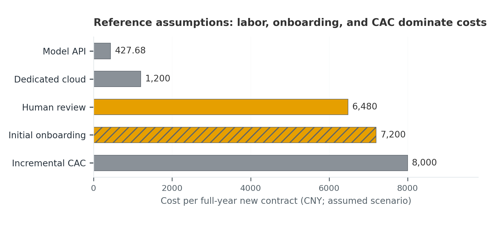

## 13. Manual-review cost sensitivity

[PNG](assets/en/business-review-stress.png) · [PDF](assets/en/business-review-stress.pdf) · [SVG](assets/en/business-review-stress.svg)

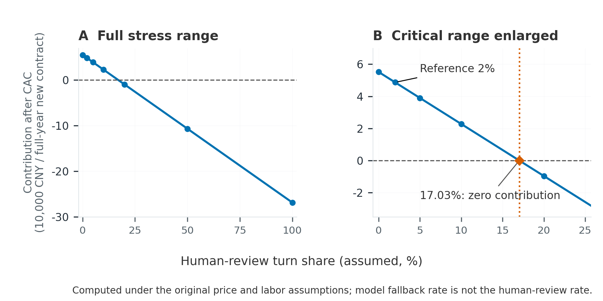

## 14. Conditional cash scenarios

[PNG](assets/en/business-cash.png) · [PDF](assets/en/business-cash.pdf) · [SVG](assets/en/business-cash.svg)

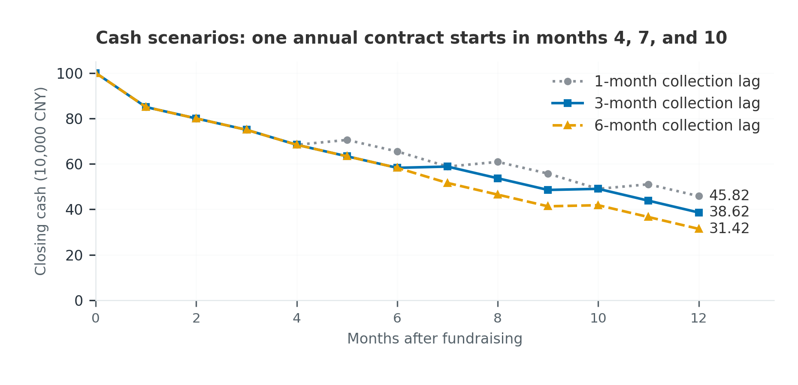
