[English](figures.md) | [简体中文](figures.zh-CN.md)

# 图表总览

这里直接显示PNG。数据、结论与报告一致；每图附PNG、PDF和可用SVG链接。矢量文件预览失败时，仍可查看PNG或下载源文件。

[查看文件与下载说明](../docs/viewing-files.md) · [中文报告](research-report.zh-CN.pdf)

## 1. 数据合成与评价边界

[PNG](assets/zh/synthesis-atlas.png) · [PDF](assets/zh/synthesis-atlas.pdf) · [SVG](assets/zh/synthesis-atlas.svg)

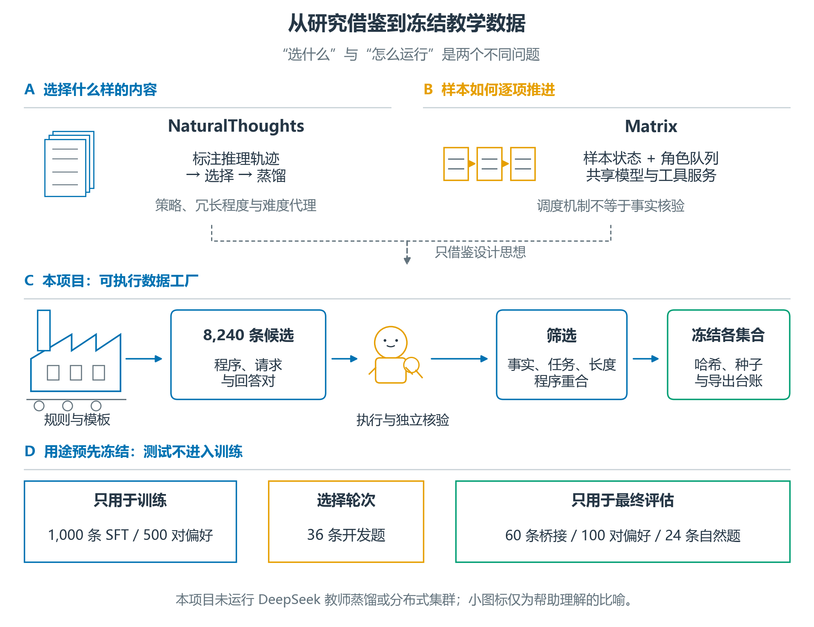

## 2. 筛选策略对比

[PNG](assets/zh/selection-ablation.png) · [PDF](assets/zh/selection-ablation.pdf)

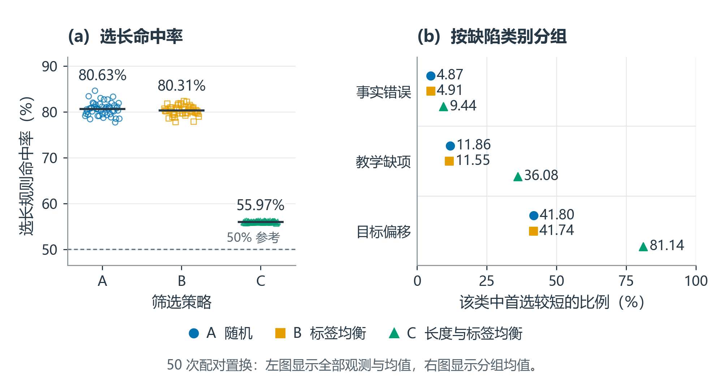

## 3. 题族中的短回答供给

[PNG](assets/zh/family-supply.png) · [PDF](assets/zh/family-supply.pdf)

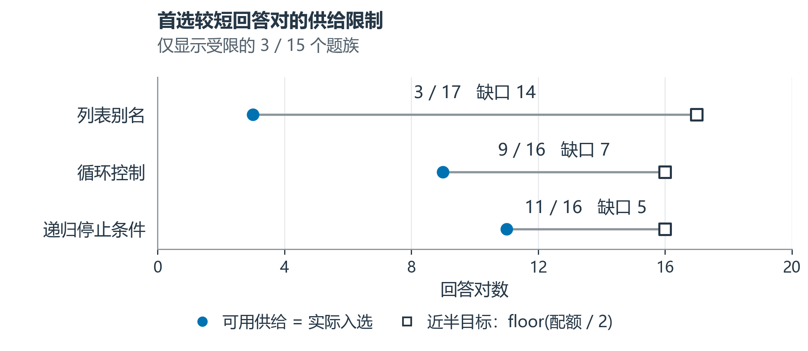

## 4. 首轮云端逐题证据

[PNG](assets/zh/training-v2-evidence.png) · [PDF](assets/zh/training-v2-evidence.pdf)

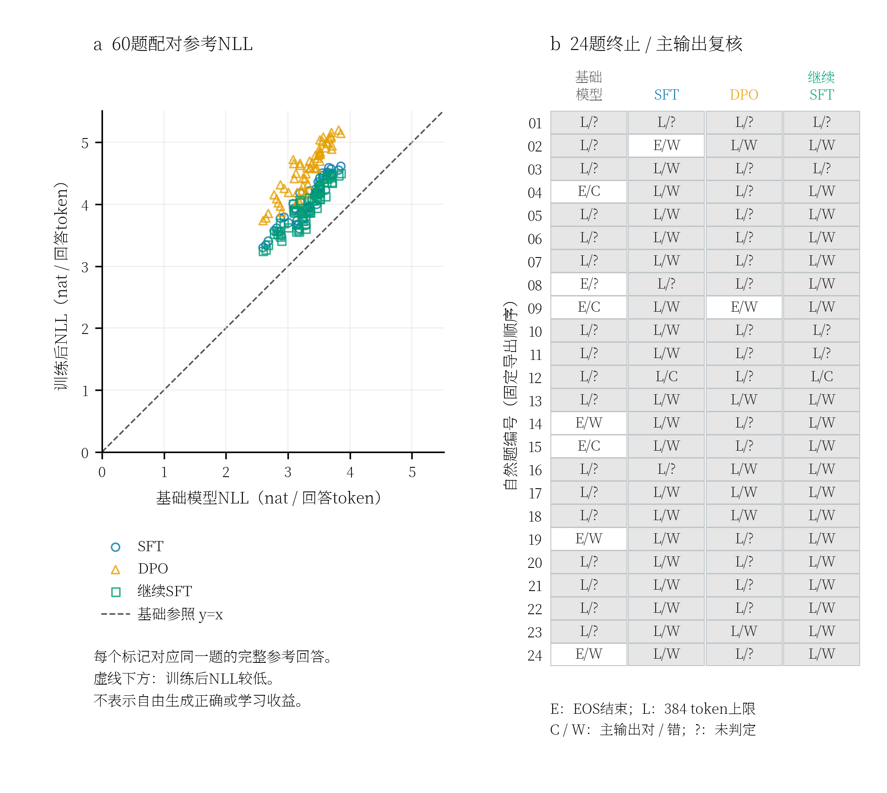

## 5. 探索性训练对比

[PNG](assets/zh/training-retry-comparison.png) · [PDF](assets/zh/training-retry-comparison.pdf)

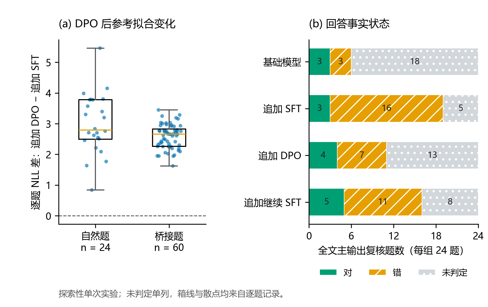

## 6. 相对目标与绝对似然

[PNG](assets/zh/training-objective-gap.png) · [PDF](assets/zh/training-objective-gap.pdf) · [SVG](assets/zh/training-objective-gap.svg)

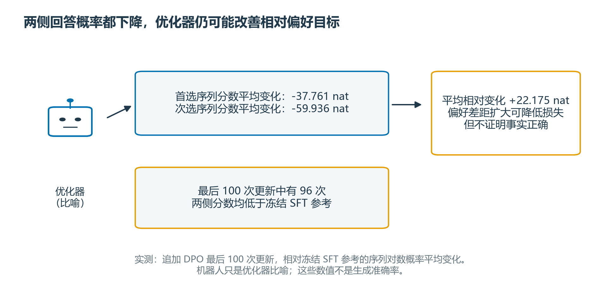

## 7. 教学角色、证据与记忆

[PNG](assets/zh/teaching-memory.png) · [PDF](assets/zh/teaching-memory.pdf) · [SVG](assets/zh/teaching-memory.svg)

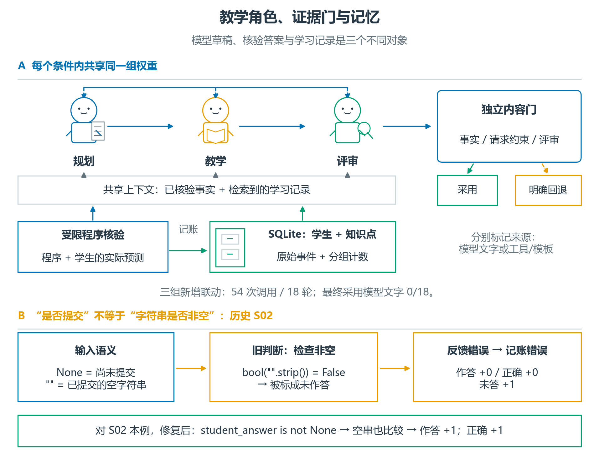

## 8. 历史智能体与记忆证据

[PNG](assets/zh/agents-evidence.png) · [PDF](assets/zh/agents-evidence.pdf)

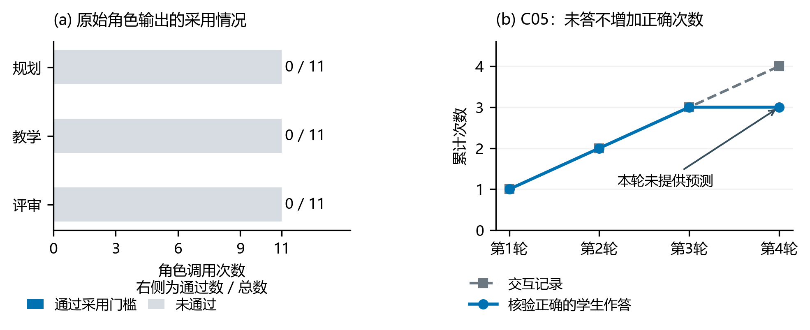

## 9. 四个历史案例

[PNG](assets/zh/case-outcomes.png) · [PDF](assets/zh/case-outcomes.pdf) · [SVG](assets/zh/case-outcomes.svg)

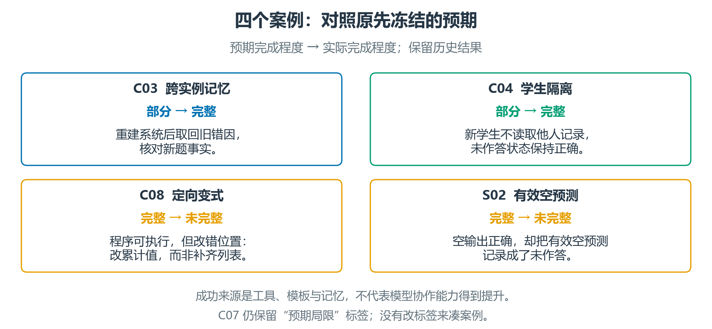

## 10. 控制器与模型来源

[PNG](assets/zh/agents-revision-provenance.png) · [PDF](assets/zh/agents-revision-provenance.pdf)

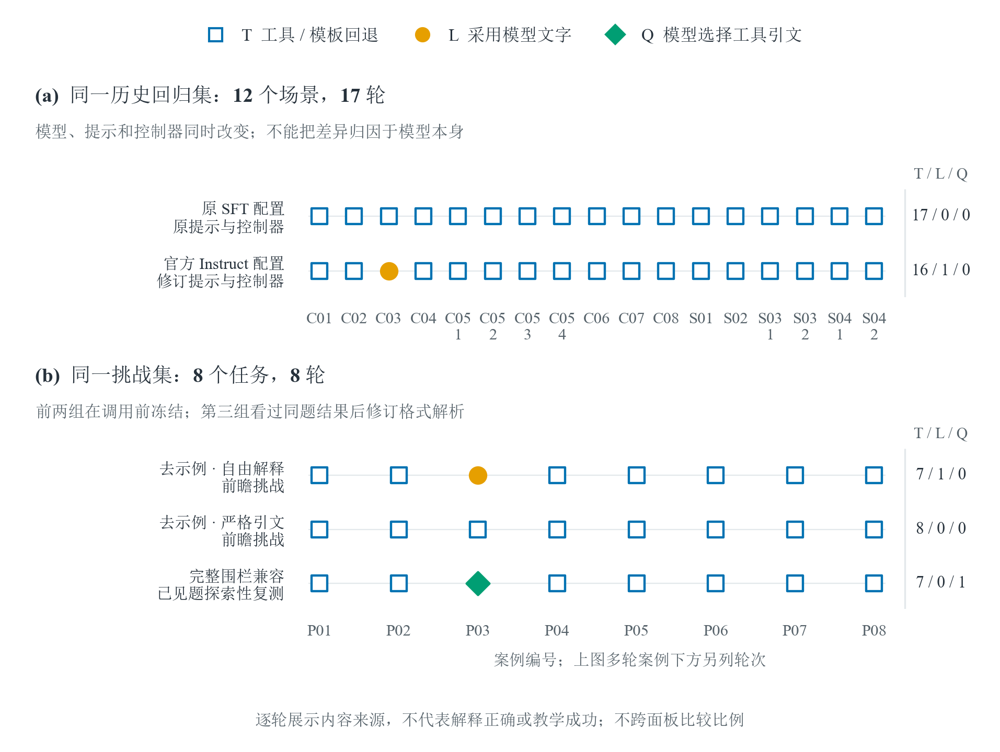

## 11. 从证据到试点

[PNG](assets/zh/evidence-to-pilot.png) · [PDF](assets/zh/evidence-to-pilot.pdf) · [SVG](assets/zh/evidence-to-pilot.svg)

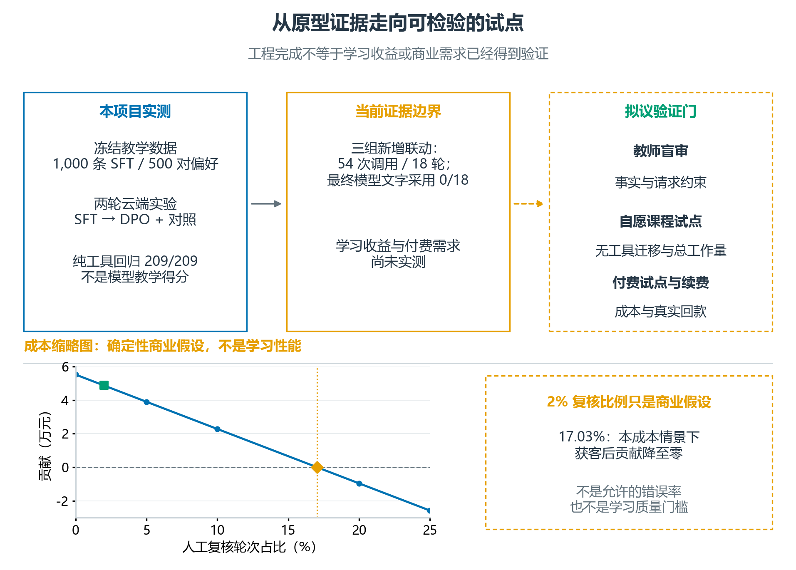

## 12. 条件性服务成本

[PNG](assets/zh/business-costs.png) · [PDF](assets/zh/business-costs.pdf)

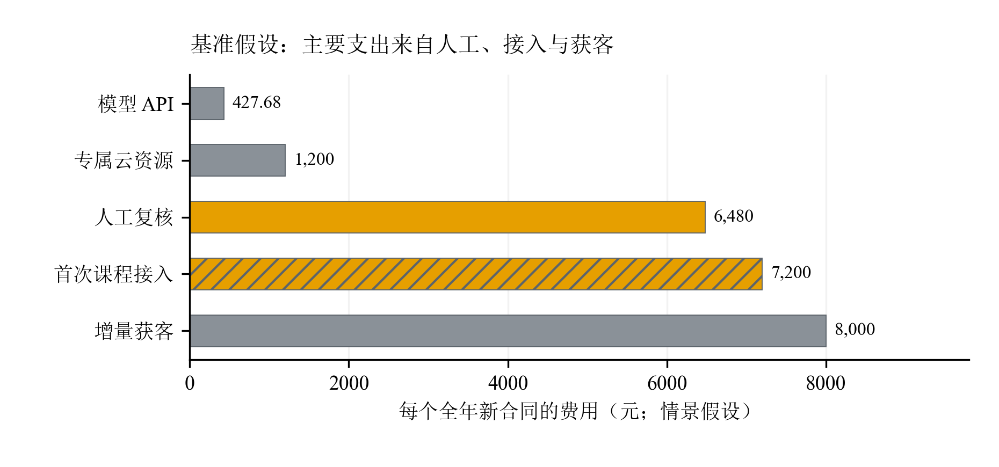

## 13. 人工复核成本敏感性

[PNG](assets/zh/business-review-stress.png) · [PDF](assets/zh/business-review-stress.pdf)

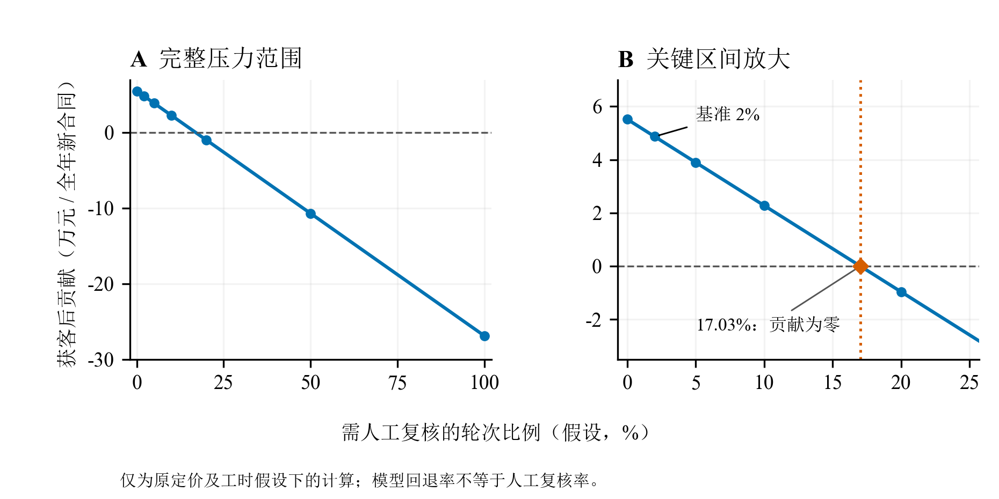

## 14. 条件性现金情景

[PNG](assets/zh/business-cash.png) · [PDF](assets/zh/business-cash.pdf)

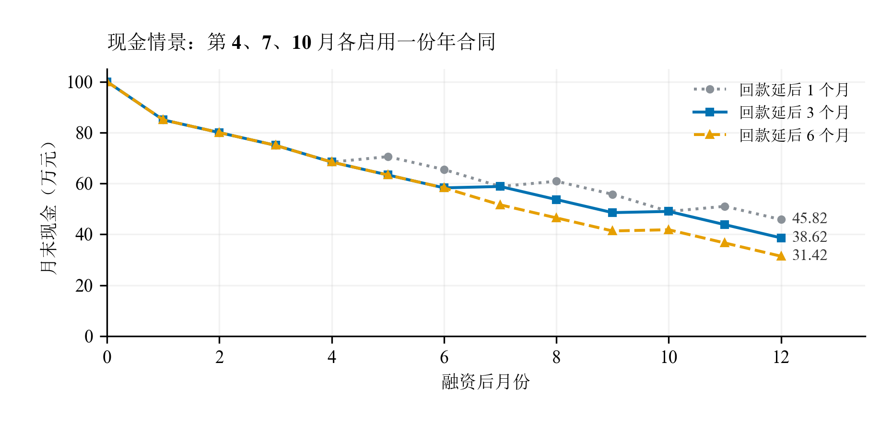
